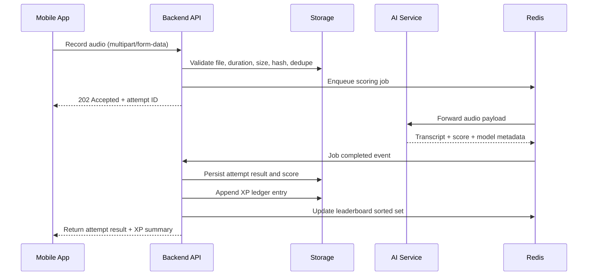

# Audit Report

## Scope and audit basis

This audit covers the repository currently checked out in this workspace. The repository is a minimal Expo application, not the full monorepo described in the product brief. At the time of audit, there is no backend service, no PostgreSQL schema, no Redis layer, no AI service, and no auth or teacher dashboard implementation in the repository. The app currently hardcodes an external API endpoint and sends user-controlled values directly from the client. The findings below are therefore based on the code that exists in this repo, plus the contract implied by the client-side fetch calls.

## 5.1 Current state inventory

### Repository inventory

| File                | Responsibility                                                                                                                        | Dependencies                               | Exposed endpoints and current contract                                                                                                                                                                                                                       |
| ------------------- | ------------------------------------------------------------------------------------------------------------------------------------- | ------------------------------------------ | ------------------------------------------------------------------------------------------------------------------------------------------------------------------------------------------------------------------------------------------------------------ |
| `App.js`            | Single-screen learning app. Renders the Bhaswara home, lesson cards, quiz mode, speech input fallback, culture feed, and leaderboard. | React, React Native, Expo runtime, `fetch` | Client calls an external backend at `http://192.168.56.1:3000` and assumes the following contract: `GET /user/:username`, `GET /lessons/sunda`, `GET /culture`, `GET /leaderboard`, `POST /xp`, `POST /score`. No server implementation exists in this repo. |
| `index.js`          | Expo app bootstrap. Registers the root component.                                                                                     | Expo runtime                               | None                                                                                                                                                                                                                                                         |
| `app.json`          | Expo configuration metadata and native app descriptors.                                                                               | Expo CLI                                   | None                                                                                                                                                                                                                                                         |
| `package.json`      | Declares app dependencies and Expo scripts.                                                                                           | Expo 58, React 19.3.0, React Native 0.88.1 | None                                                                                                                                                                                                                                                         |
| `assets/*`          | App assets such as icons and favicon                                                                                                  | Expo asset pipeline                        | None                                                                                                                                                                                                                                                         |
| `package-lock.json` | Lockfile for npm installation                                                                                                         | npm ecosystem                              | None                                                                                                                                                                                                                                                         |

### Inferred API contract from the client

The app defines the following client-side requests in `App.js`:

```js
const API = "http://192.168.56.1:3000";
const USER = "adnan";

const get = (p) => fetch(API + p).then((r) => r.json());
const post = (p, b) =>
  fetch(API + p, {
    method: "POST",
    headers: { "Content-Type": "application/json" },
    body: JSON.stringify(b),
  }).then((r) => r.json());
```

Observed call sites:

- `GET /user/adnan`
  - Expected response: `{ xp: number, streak: number }`
  - Observed usage: `setMe` is assigned to the result.

- `GET /lessons/sunda`
  - Expected response: an array of lesson objects, each shaped approximately as `{ id, word, meaning }`.
  - Observed usage: `setItems(items)`; `cur.word`, `cur.meaning`, `cur.id` are read directly.

- `POST /xp`
  - Request body: `{ username: string, amount: number }`
  - Observed usage: `await post("/xp", { username: USER, amount: 10 })` on correct quiz answer.
  - Safety risk: the client can send arbitrary `amount` and arbitrary `username` values.

- `POST /score`
  - Request body: `{ username: string, target: string, heard: string }`
  - Expected response: `{ score: number, xpGained: number, feedback: string }`
  - Observed usage: the mobile app displays score and feedback directly.

- `GET /culture`
  - Expected response: an array of cultural entries shaped like `{ title, fact }`.

- `GET /leaderboard`
  - Expected response: an array of leaderboard rows shaped like `{ name, xp }`.

### Current state conclusion

There is no implementation of the required target architecture in the repository. The app is a prototype that assumes a server exists on a local IP and sends mutable state over unauthenticated HTTP. The current repo does not meet the Bhaswara target stack or the security model defined in the design brief.

## 5.2 Code correctness and robustness

### Findings

1. Empty lesson payload handling is weak.
   - Evidence: `if (!items.length) return <Text style={s.err}>Memuat...</Text>;`
   - Risk: the app handles an empty dataset as a loading state even when the backend has responded successfully with an empty list. This produces a silent false-positive loading experience and makes the lesson flow appear hung.

2. Quiz option generation is not robust and is not guaranteed to be unique.
   - Evidence: `wrong = items.filter((x) => x.id !== cur.id).slice(i % 5, (i % 5) + 3).map((x) => x.meaning); const options = [...wrong]; options.splice(i % 4, 0, cur.meaning);`
   - Risk: duplicate answers are possible because the selection logic does not enforce uniqueness, uses an index into a filtered list, and can emit repeated meanings if the dataset is small, contains duplicate translations, or the list is short. The UI includes `key={o}` on each option, so duplicates would also create unstable list identity in React.

3. Network failures are handled inconsistently and can produce rejected async flows.
   - Evidence: `refresh = () => get("/user/" + USER).then(setMe).catch(() => {});` and `answer`/`submitSpeech` call `await post(...)` without `try/catch`.
   - Risk: a failed POST from a quiz or speech attempt can throw asynchronously, leaving the app in an inconsistent state with no user-visible error message.

4. Double-submission protection is weak.
   - Evidence: `disabled={!!picked}` prevents repeated taps within the same render cycle, but the app does not enforce idempotency on the server or on the client across retries.
   - Risk: a malicious or accidental client can fire multiple `/xp` requests for the same item in the same session if the network is slow or if the app is refreshed.

5. XP can be awarded repeatedly for the same item.
   - Evidence: the server contract is absent, but the client simply calls `/xp` with `amount: 10` when a quiz answer is correct. There is no item-specific or daily deduplication logic in the app.
   - Risk: the app intentionally rewards on every correct answer without any deduplication by item, user, or day, making XP farming trivial if the backend accepts the request.

6. Negative or very large XP values are accepted from the client.
   - Evidence: `amount: 10` is passed by the client, with no validation or minimum/maximum bounds.
   - Risk: if the backend accepts arbitrary numeric values, a client can submit negative or extremely large values to corrupt the ledger.

7. Streak logic is not defined at the app level and is not robust against timezone boundaries.
   - Evidence: the UI displays `me.streak` but no local-time computation is visible in the client. The product brief requires timezone-aware daily XP and daily streak logic.
   - Risk: the app will miscalculate streaks when users cross time zones or when the UTC date differs from the local calendar date.

8. Unhandled promise rejections are possible.
   - Evidence: multiple `fetch` flows rely on `.then(...)` without a final `catch`, and `await post` is not wrapped in `try/catch`.
   - Risk: transient backend issues or permission problems can surface as unhandled promise rejections in production.

### Correctness conclusion

The current code is a prototype that performs the right user flow at a rough level, but it is not robust enough for a production-grade educational app or for the product requirements in the brief. The most serious logic gap is that the client currently controls the identity and XP event, which is incompatible with the required server-side ledger model.

## 5.3 Streak and time handling

### Current UTC-day behavior and user impact

The app currently exposes a `streak` value but the logic is not implemented in this repo. The product brief explicitly calls out a UTC-based approach as a known risk. In a server that computes the day using UTC instead of the user's timezone, the following issue appears:

- In Indonesia, local time is UTC+7, UTC+8, and UTC+9.
- The local calendar day can differ from UTC by one day during the early hours of the morning.
- For WIB users, the window between 00:00 and 07:00 local time still falls on the previous UTC date.
- Example: a user in Jakarta may log activity at 01:30 WIB; if the server uses UTC, it will still read the previous UTC day. That can incorrectly reset or delay the streak even though the user already satisfied the local daily requirement.
- The same problem is amplified in WITA and WIT, where the offset is +8 and +9.

This is not a cosmetic issue. Users living near the local-day boundary can lose progress or gain it unexpectedly based solely on server timezone choice.

### Corrected design

The correct design is:

1. Store a user timezone as an IANA timezone string, such as `Asia/Jakarta`, `Asia/Makassar`, or `Asia/Jayapura`.
2. Store the user locale as a profile field, not as a client-only preference.
3. Compute the current local calendar day on the server using the user's saved timezone and a timezone-aware date function.
4. Determine whether a day counts based on that local-day value, not UTC.
5. Grace behavior for timezone changes and travel:
   - keep the prior timezone as a profile history if the user changes it manually;
   - treat a timezone change as a local-day transition only after the user has made a new daily activity attempt in the new zone;
   - allow a one-day continuity buffer when travel crosses time zone boundaries so a missed local day does not instantly break the streak if the user is in transit;
   - do not silently award a streak for future-dated activity.
6. Streak freeze rule:
   - one freeze per ISO week;
   - the freeze prevents a missed local day from breaking the streak;
   - freeze usage is recorded in a ledger and must be server-side, not client-controlled;
   - freeze eligibility is based on a user already having at least one qualifying activity in the same ISO week.

### Required test cases

| Test case                   | Scenario                                                                      | Expected result                                                                  |
| --------------------------- | ----------------------------------------------------------------------------- | -------------------------------------------------------------------------------- |
| WIB midnight boundary       | User in `Asia/Jakarta` earns enough XP at 00:30 local time                    | The activity is counted on the local day of 00:30, not the previous UTC day      |
| WIB early-morning lag       | User in `Asia/Jakarta` at 06:30 local time and UTC date is still previous day | Streak remains valid if the local date is the active day                         |
| WITA boundary               | User in `Asia/Makassar` at 00:15 local time                                   | Activity is attributed to the local day, not UTC                                 |
| WIT boundary                | User in `Asia/Jayapura` at 00:20 local time                                   | Activity is attributed to the local date, not UTC                                |
| Time-zone travel west       | User travels from WIB to UTC and logs in after 02:00 local time               | Continuity is preserved if the local-day gap is within the grace window          |
| Time-zone travel east       | User travels across regions with a large advance in local time                | Streak is not broken unless a full local-day gap exceeds the defined grace rule  |
| Freeze use                  | User misses one day but has one freeze available in the ISO week              | Streak remains active after freeze credit                                        |
| Freeze exhaustion           | User has already used the weekly freeze                                       | Next missed day breaks the streak unless another valid local-day activity occurs |
| Duplicate daily credit      | User earns XP multiple times in the same local day                            | Only the first valid daily qualifying event counts toward the streak             |
| Invalid future-day activity | User posts a timestamp from tomorrow relative to server local time            | Server rejects or does not count the event                                       |

## 5.4 Security review

### Findings summary

| Finding                                 | Evidence                                                                                        | Impact                                                                              | Recommended fix                                                                          |
| --------------------------------------- | ----------------------------------------------------------------------------------------------- | ----------------------------------------------------------------------------------- | ---------------------------------------------------------------------------------------- |
| Client-controlled identity              | `const USER = "adnan";` and `post("/xp", { username: USER, amount: 10 })`                       | A client can impersonate any username or repeatedly submit XP for another account   | Move identity to authenticated server-side session and discard client-provided usernames |
| Unauthenticated XP endpoint             | `POST /xp` can be called with arbitrary values from the client without server-side verification | XP farming and ledger corruption                                                    | Require auth, idempotency key, and server-generated XP ledger entries only               |
| HTTP instead of HTTPS                   | `const API = "http://192.168.56.1:3000"`                                                        | Credentials, audio, and user activity travel in cleartext on the network            | Require HTTPS in production and enforce TLS in deployment and mobile configuration       |
| Unbounded request body and content size | No request-size limits or payload validation are visible in the app                             | Large or malformed payloads can cause memory or CPU pressure on the server          | Enforce body size limits and schema validation at the API boundary                       |
| Permissive CORS                         | Not defined in repo, but client-side fetch from local IP suggests no trust boundary             | Any origin may call the API if configured permissively                              | Use strict allowlist and verified origin checks                                          |
| No rate limiting                        | No rate limits in app or server implementation                                                  | Brute force, botting, and leaderboard scraping                                      | Add per-IP and per-user rate limits at the gateway and app API                           |
| Missing security headers                | No Helmet or equivalent in repo                                                                 | Browser and API protections are absent                                              | Add secure response headers and strict content policies                                  |
| Enumeration risk                        | `GET /user/:username` and leaderboard data allow user discovery                                 | Profile scraping and user enumeration                                               | Require auth for profile and ranking endpoints; hide existence where not needed          |
| Replay of correct pronunciation         | The app posts `heard` text and score request with no anti-replay protection                     | A user could resubmit a previously recorded correct phrase to harvest XP repeatedly | Use per-item, per-user, time-bounded anti-replay checks and server-side scoring          |

### Mapping to security standards

- OWASP ASVS:
  - V2.1 Authentication and session management
  - V2.2 Credential recovery and reset
  - V3.3 Sensitive data in transit
  - V5.1 Input validation and sanitization
  - V5.2 Output encoding and serialization
  - V8.2 Protection against authorization bypasses
  - V9.1 Access control enforcement
  - V12.3 Logging and auditability
- OWASP Mobile Top 10:
  - M1: Improper Credential Usage
  - M2: Insecure Data Storage
  - M3: Insecure Communication
  - M5: Insufficient Cryptography / Transport hardening
  - M6: Insecure Authorization
  - M9: Security Misconfiguration

### Security conclusion

The repo, as written, violates the minimum security assumptions for the Bhaswara product. The most severe issue is that the client controls identity and sends arbitrary XP award values to a server that is not present in the repository. This is not a minor quality issue; it is a design incompatibility with the required architecture and security baseline.

## 5.5 Threat model

### STRIDE table

| Area                                | Threat                                              | Category                           | Impact                                     | Recommended control                                                                                 |
| ----------------------------------- | --------------------------------------------------- | ---------------------------------- | ------------------------------------------ | --------------------------------------------------------------------------------------------------- |
| Authentication and session handling | User impersonation via client-controlled `username` | Spoofing                           | Account takeover and XP farming            | Replace username with authenticated identity and encrypted refresh/session tokens                   |
| Authentication and session handling | Reuse of refresh tokens or stolen session cookies   | Tampering / Elevation of privilege | Unauthorized access                        | Rotation, family binding, replay detection, and revocation                                          |
| Audio upload                        | Oversized or malformed audio uploaded to the API    | Denial of service                  | Service degradation                        | File-size limits, MIME validation, content-type checks, and duration limits                         |
| Audio upload                        | Reused audio hash across users or items             | Spoofing                           | Duplicate scoring and cheating             | Per-user/per-item anti-replay checks and a 24-hour dedupe window                                    |
| Backend to AI service               | Request manipulation and model abuse                | Tampering                          | Unbounded CPU or payout abuse              | Strict schema validation, queue limits, request quotas, and authenticated service-to-service tokens |
| Leaderboard                         | Bulk scraping or abusive leaderboard automation     | Information disclosure             | UI scraping and unfair ranking             | Authenticated leaderboard API, rate limiting, and partial visibility rules                          |
| Teacher dashboard                   | Unauthorized role escalation                        | Elevation of privilege             | Data leakage                               | Server-side RBAC, middleware checks, and route-level tests                                          |
| Dataset contribution flow           | Inappropriate public data release                   | Information disclosure             | Consent and privacy violations             | Consent capture, review workflow, and explicit data retention rules                                 |
| XP ledger                           | Scripted XP farming                                 | Tampering                          | Unfair gameplay and leaderboard distortion | Server-generated ledger only, anomaly flags, and daily caps                                         |
| Class system                        | Student impersonation inside a class                | Spoofing                           | False progress marks                       | Classroom membership validation and teacher-issued invitations                                      |

### Abuse cases to handle explicitly

- XP farming with scripts: server-side XP ledger only, daily caps, anomaly detection, and idempotency keys.
- Leaderboard scraping: hide raw user identifiers and enforce per-user access and rate limits.
- Oversized or malformed audio: reject before the AI service sees the payload.
- Decompression-style attacks on audio containers: validate by content type and decode the file in a sandboxed parser before accepting it.
- Parent or teacher account takeover: enforce MFA and audit log all role changes.
- Student impersonation inside a class: student identity must be bound to authenticated accounts with class membership verification.

## 5.6 Architecture review

### Decision 1: PostgreSQL versus document store

Recommendation: use PostgreSQL for the core product data model.

Trade-off: document stores simplify flexible JSON payloads, but Bhaswara is built around relational rules such as consent tracking, classroom membership, leaderboard reconciliation, XP ledger integrity, and teacher-role access control. PostgreSQL provides the needed transactional guarantees, auditability, and query patterns at a lower complexity cost than a hybrid architecture.

### Decision 2: server-side versus on-device speech inference

Recommendation: perform speech scoring on the server, not on-device, for the MVP.

Trade-off: on-device inference is attractive for latency and privacy, but it would force the app to ship a model and maintain device-specific performance. The product requires consistent evaluation, versioning, and auditability for pronunciation scoring. A single server-side scoring service is simpler to test and easier to scale for a small pilot.

### Decision 3: synchronous versus queued scoring

Recommendation: use a queued scoring pipeline, with a synchronous API response that acknowledges receipt and returns a status reference.

Trade-off: synchronous scoring is simpler to prototype but weakens resilience under load and makes the user experience worse when AI inference is slow or unstable. A queue allows back-pressure control, retries, and reliable cost and latency management while still presenting a fast user experience.

### Decision 4: where scoring thresholds live

Recommendation: scoring thresholds live in configuration and database metadata, not inside application code.

Trade-off: hardcoded thresholds are easier to prototype but impossible to tune safely without a new release. Product requirements explicitly require thresholds to be configuration-driven for versioning and experimentation.

### Mermaid sequence diagram



## 5.7 Data model

The full target schema is a relational design with PostgreSQL. The following is the recommended model for the product and is aligned with the brief.

### Core tables

```sql
CREATE TABLE users (
  id UUID PRIMARY KEY,
  email CITEXT UNIQUE NOT NULL,
  password_hash TEXT NOT NULL,
  email_verified BOOLEAN NOT NULL DEFAULT FALSE,
  created_at TIMESTAMPTZ NOT NULL DEFAULT now(),
  deleted_at TIMESTAMPTZ NULL
);

CREATE TABLE user_profiles (
  user_id UUID PRIMARY KEY REFERENCES users(id),
  display_name TEXT,
  timezone TEXT NOT NULL DEFAULT 'Asia/Jakarta',
  locale TEXT NOT NULL DEFAULT 'id',
  birth_date DATE,
  consent_version INT NOT NULL DEFAULT 0,
  avatar_id UUID,
  status TEXT NOT NULL DEFAULT 'active'
);

CREATE TABLE guardians (
  id UUID PRIMARY KEY,
  user_id UUID NOT NULL REFERENCES users(id),
  guardian_user_id UUID REFERENCES users(id),
  relationship TEXT,
  consent_status TEXT NOT NULL
);

CREATE TABLE consents (
  id UUID PRIMARY KEY,
  user_id UUID NOT NULL REFERENCES users(id),
  purpose TEXT NOT NULL,
  version INT NOT NULL,
  granted BOOLEAN NOT NULL,
  granted_at TIMESTAMPTZ,
  withdrawn_at TIMESTAMPTZ,
  UNIQUE (user_id, purpose, version)
);
```

### Curriculum and content

```sql
CREATE TABLE languages (
  id UUID PRIMARY KEY,
  code TEXT UNIQUE NOT NULL,
  name TEXT NOT NULL,
  is_active BOOLEAN NOT NULL DEFAULT TRUE
);

CREATE TABLE dialects (
  id UUID PRIMARY KEY,
  language_id UUID NOT NULL REFERENCES languages(id),
  code TEXT NOT NULL,
  name TEXT NOT NULL,
  UNIQUE (language_id, code)
);

CREATE TABLE lessons (
  id UUID PRIMARY KEY,
  language_id UUID NOT NULL REFERENCES languages(id),
  title TEXT NOT NULL,
  slug TEXT NOT NULL UNIQUE,
  order_index INT NOT NULL,
  is_published BOOLEAN NOT NULL DEFAULT FALSE
);

CREATE TABLE lesson_items (
  id UUID PRIMARY KEY,
  lesson_id UUID NOT NULL REFERENCES lessons(id),
  item_type TEXT NOT NULL CHECK (item_type IN ('vocabulary', 'quiz', 'pronunciation')),
  order_index INT NOT NULL
);

CREATE TABLE vocabulary (
  id UUID PRIMARY KEY,
  language_id UUID NOT NULL REFERENCES languages(id),
  dialect_id UUID REFERENCES dialects(id),
  word TEXT NOT NULL,
  meaning TEXT NOT NULL,
  ipa TEXT,
  audio_required BOOLEAN NOT NULL DEFAULT FALSE
);

CREATE TABLE vocabulary_audio_reference (
  id UUID PRIMARY KEY,
  vocabulary_id UUID NOT NULL REFERENCES vocabulary(id),
  source_uri TEXT NOT NULL,
  checksum TEXT NOT NULL,
  provider TEXT NOT NULL,
  review_status TEXT NOT NULL DEFAULT 'pending'
);
```

### Learning, scoring, and gamification

```sql
CREATE TABLE attempts (
  id UUID PRIMARY KEY,
  user_id UUID NOT NULL REFERENCES users(id),
  lesson_item_id UUID REFERENCES lesson_items(id),
  vocabulary_id UUID REFERENCES vocabulary(id),
  score NUMERIC(5,2) NOT NULL,
  model_version TEXT NOT NULL,
  transcript TEXT,
  duration_ms INT,
  status TEXT NOT NULL CHECK (status IN ('queued', 'processing', 'completed', 'failed', 'rejected')),
  created_at TIMESTAMPTZ NOT NULL DEFAULT now(),
  completed_at TIMESTAMPTZ
);

CREATE TABLE xp_events (
  id UUID PRIMARY KEY,
  user_id UUID NOT NULL REFERENCES users(id),
  source_type TEXT NOT NULL,
  source_id UUID NOT NULL,
  delta_xp INT NOT NULL,
  reason TEXT NOT NULL,
  idempotency_key TEXT NOT NULL,
  created_at TIMESTAMPTZ NOT NULL DEFAULT now(),
  UNIQUE (user_id, idempotency_key)
);

CREATE TABLE streaks (
  user_id UUID PRIMARY KEY REFERENCES users(id),
  current_streak INT NOT NULL DEFAULT 0,
  longest_streak INT NOT NULL DEFAULT 0,
  last_valid_day DATE,
  updated_at TIMESTAMPTZ NOT NULL DEFAULT now()
);

CREATE TABLE streak_freezes (
  id UUID PRIMARY KEY,
  user_id UUID NOT NULL REFERENCES users(id),
  iso_week TEXT NOT NULL,
  remains INT NOT NULL DEFAULT 1,
  used_at TIMESTAMPTZ,
  UNIQUE (user_id, iso_week)
);

CREATE TABLE achievements (
  id UUID PRIMARY KEY,
  code TEXT UNIQUE NOT NULL,
  name TEXT NOT NULL,
  description TEXT NOT NULL
);

CREATE TABLE user_achievements (
  user_id UUID NOT NULL REFERENCES users(id),
  achievement_id UUID NOT NULL REFERENCES achievements(id),
  unlocked_at TIMESTAMPTZ NOT NULL DEFAULT now(),
  PRIMARY KEY (user_id, achievement_id)
);
```

### Avatars and social layers

```sql
CREATE TABLE avatars (
  id UUID PRIMARY KEY,
  name TEXT NOT NULL,
  default_theme TEXT NOT NULL,
  is_active BOOLEAN NOT NULL DEFAULT TRUE
);

CREATE TABLE avatar_items (
  id UUID PRIMARY KEY,
  avatar_id UUID NOT NULL REFERENCES avatars(id),
  item_type TEXT NOT NULL,
  item_key TEXT NOT NULL,
  costume_name TEXT NOT NULL,
  is_locked BOOLEAN NOT NULL DEFAULT TRUE,
  UNIQUE (avatar_id, item_type, item_key)
);

CREATE TABLE schools (
  id UUID PRIMARY KEY,
  name TEXT NOT NULL,
  region TEXT NOT NULL
);

CREATE TABLE classes (
  id UUID PRIMARY KEY,
  teacher_user_id UUID NOT NULL REFERENCES users(id),
  school_id UUID REFERENCES schools(id),
  invite_code TEXT NOT NULL UNIQUE,
  name TEXT NOT NULL,
  created_at TIMESTAMPTZ NOT NULL DEFAULT now()
);

CREATE TABLE class_members (
  user_id UUID NOT NULL REFERENCES users(id),
  class_id UUID NOT NULL REFERENCES classes(id),
  role TEXT NOT NULL CHECK (role IN ('student', 'teacher', 'guardian')),
  joined_at TIMESTAMPTZ NOT NULL DEFAULT now(),
  PRIMARY KEY (user_id, class_id)
);
```

### Content and governance

```sql
CREATE TABLE cultural_content (
  id UUID PRIMARY KEY,
  language_id UUID REFERENCES languages(id),
  title TEXT NOT NULL,
  content_type TEXT NOT NULL,
  body TEXT,
  source TEXT,
  author TEXT,
  review_status TEXT NOT NULL CHECK (review_status IN ('draft', 'pending', 'approved', 'rejected')),
  published_at TIMESTAMPTZ,
  created_by UUID REFERENCES users(id)
);

CREATE TABLE audit_log (
  id UUID PRIMARY KEY,
  actor_user_id UUID REFERENCES users(id),
  action TEXT NOT NULL,
  entity_type TEXT NOT NULL,
  entity_id UUID,
  metadata JSONB NOT NULL DEFAULT '{}'::jsonb,
  created_at TIMESTAMPTZ NOT NULL DEFAULT now()
);

CREATE TABLE refresh_tokens (
  id UUID PRIMARY KEY,
  user_id UUID NOT NULL REFERENCES users(id),
  token_family UUID NOT NULL,
  token_hash TEXT NOT NULL,
  expires_at TIMESTAMPTZ NOT NULL,
  revoked_at TIMESTAMPTZ,
  created_at TIMESTAMPTZ NOT NULL DEFAULT now(),
  last_used_at TIMESTAMPTZ
);
```

### Derived versus stored values

- Derived values:
  - current XP total
  - leaderboards
  - current streak count
  - level
  - words mastered per user
  - daily completion status
  - onboarding and consent status summaries

- Stored values:
  - raw XP events
  - user profiles and timezones
  - consent records
  - classroom membership
  - audio metadata, hashes, and scoring attempts
  - leaderboard snapshots only if used for a query optimization

- Rationale for denormalization:
  - `current_streak` is denormalized for read-heavy UI and scoreboard access.
  - leaderboard scores and user rank are materialized in Redis and periodically reconciled from the ledger.
  - `xp_total` should be computed in a transaction from the ledger, not trusted from the client.

### Indexes and constraints

Required indexes:

- `users(email)` unique
- `user_profiles(timezone)`
- `attempts(user_id, created_at)`
- `attempts(user_id, vocabulary_id, created_at)`
- `xp_events(user_id, created_at)`
- `streak_freezes(user_id, iso_week)`
- `classes(invite_code)` unique
- `class_members(class_id, role)`
- `cultural_content(review_status, published_at)`

Constraints:

- XP deltas are integers with a check on sign and source limitations.
- Idempotency key is unique per user and source.
- `score` in attempts must be within 0 to 100.
- `duration_ms` must be positive.
- `review_status` values must be restricted to valid enumerations.

## 5.8 Speech and AI analysis

### What is known and unknown about Whisper coverage

Known from the brief: the target AI stack is Whisper via Hugging Face Transformers with a FastAPI service. What is known and unknown differs by language:

- Known from product scope: Sundanese must be supported in the MVP.
- Unknown without an experiment: coverage quality for Javanese, Balinese, Bugis, and Minangkabau is not yet verified in this repo, and there are no benchmark results available.
- Experiment required for each language: run a small evaluation set and measure WER on native-speaker recordings with dialect variants before claiming coverage quality.

### Three scoring tiers

1. Tier A: ASR transcript with normalized edit distance
   - Best for fast MVP and controlled wordlists.
   - Good for simple evaluation and low latency.
   - Weak when pronunciation variation is meaningful.

2. Tier B: word-level confidence combined with forced alignment
   - Better balance of explainability and robustness.
   - Useful for reading and pronunciation scoring with known target words.

3. Tier C: phoneme-level scoring
   - Best accuracy for detailed pronunciation feedback.
   - Highest complexity and cost.

Recommendation for MVP: Tier B, because it provides a machine-readable pronunciation signal without the cost and operational complexity of full phoneme alignment.

Criteria for moving to Tier C:

- WER is already acceptable for the target languages;
- pronunciation score correlates strongly with human raters;
- the app has accepted a higher inference budget;
- the training or evaluation pipeline is in place and versioned.

### Evaluation protocol

- Held-out dataset of native-speaker recordings, stratified by age, region, and dialect.
- Use word error rate (WER) as the ASR metric.
- Use Spearman correlation between system scores and ratings from at least three native-speaker raters as the scoring metric.
- Use Krippendorff alpha to measure inter-rater agreement.
- Release gate:
  - WER below the threshold for the target language and word set;
  - Spearman correlation above the threshold for acceptance;
  - minimum inter-rater agreement qualifies the label set;
  - no critical mismatches in the review of edge-case words.

### Data collection plan

- Cover speaker demographics: age bands, gender balance, region, dialect, and mother-tongue status.
- Capture recording conditions: quiet room, fixed mic distance, no post-processing, same device classes as real users.
- Minimum utterances per word: at least 5 to 10 native speech samples per word, with variant coverage across local dialects.
- Quality control:
  - reject clipped or empty recordings;
  - verify label correctness before training or evaluation;
  - keep a separate validation set for release gating.

### Latency and cost budget

| Stage     | Target budget                         | Design lever                                           |
| --------- | ------------------------------------- | ------------------------------------------------------ |
| Capture   | < 200 ms for start and stop           | local recording pipeline with voice activity detection |
| Encode    | < 300 ms                              | fixed codec and chunk size                             |
| Upload    | < 1 s on 4G for short clips           | compression and streaming upload                       |
| Queue     | < 500 ms to accept, but allow backlog | worker pool with back pressure                         |
| Inference | under 3 s p95 for 5s clips            | model optimization and one model instance per service  |
| Response  | < 500 ms for result assembly          | serialized result schema and cached metadata           |

### Anti-spoofing

- Nonce prompts: use one-time prompt phrases or randomization that makes repeated playback less useful.
- Reject identical audio hashes for the same user and item within 24 hours.
- Clip-length checks: reject clips shorter than 0.5s or longer than 10s.
- Reject duplicate prompt attempts that match the same input hash with a short time delta.

## 5.9 Privacy, legal, and ethics

### Data inventory

| Data category     | Example fields                    | Purpose                    | Legal basis / assumption                | Retention                                  | Access                                   |
| ----------------- | --------------------------------- | -------------------------- | --------------------------------------- | ------------------------------------------ | ---------------------------------------- |
| Account data      | email, password hash, user ID     | authentication             | consent and contract                    | until account deletion                     | limited to admins and auth service       |
| Profile data      | timezone, display name, age       | personalization and safety | user consent                            | until deletion or profile change           | user and teacher, as applicable          |
| Voice recordings  | audio samples and transcripts     | pronunciation scoring      | explicit consent and safety necessity   | default delete after scoring unless opt-in | limited scoring service and admin review |
| Lesson progress   | XP, streak, completion status     | product functionality      | user consent and service necessity      | until account deletion                     | user, teacher with class access          |
| Guardian data     | guardian relationship and consent | child safety               | consent and legal basis under local law | until child account end                    | guardian and admin                       |
| School/class data | class membership and invite codes | teaching management        | teacher / school agreement              | as long as class is active                 | teacher and admin                        |
| Cultural content  | source, author, review status     | content curation           | explicit contribution agreements        | as policy-defined                          | triaged by editors                       |

### Indonesia legal analysis

The repo and the brief do not yet contain a formal legal analysis. The engineering requirement is to treat all voice recordings and child-related data as sensitive by default. Under Indonesia's Personal Data Protection Law, the team should treat the following as material design decisions that require legal confirmation:

- explicit consent capture and withdrawal for voice usage, scoring, and data collection;
- guardian consent for users under the legal threshold pending legal guidance;
- retention periods and deletion obligations;
- cross-border hosting if audio or metadata is stored outside Indonesia;
- subject access and account deletion timing;
- breach notification responsibilities and data processor agreements.

Assumptions to verify with counsel:

- the age threshold for child consent;
- whether voice recordings are considered sensitive personal data;
- whether public leaderboard exposure of minors is allowed;
- whether teacher or guardian access to student data requires separate consent or school agreement.

### Native-speaker contribution flow

The native-speaker contribution pipeline should include:

- consent screen explaining the purpose of the recording;
- explicit licensing terms for recording contributions;
- attribution and withdrawal process;
- clear storage and retention promises;
- review and moderation steps before data is used in production.

### Child safety

- do not allow free-text public profile fields;
- generate display names from a curated list or server-side templates;
- avoid direct messaging features in v1;
- provide leaderboard visibility controls;
- publish a reporting path for abusive behavior or unsafe content.

## 5.10 Product metrics

Definitions below use the exact metric formula and source that should be implemented by the backend analytics pipeline.

| Metric                                           | Exact formula                                                                    | Event source                                            |
| ------------------------------------------------ | -------------------------------------------------------------------------------- | ------------------------------------------------------- |
| D1 retention                                     | users active on day 1 / users who completed onboarding in the cohort             | `user_session_started` and `onboarding_completed`       |
| D7 retention                                     | users active on day 7 / users who completed onboarding in the cohort             | `user_session_started` and `onboarding_completed`       |
| Weekly active learners                           | unique learners with at least one valid learning event in the 7-day window       | `lesson_started`, `quiz_submitted`, `attempt_completed` |
| Share of active users holding a 7-day streak     | users with `current_streak >= 7` / active users in the time window               | `xp_events` and `streaks`                               |
| Lesson completion rate                           | completed lessons / started lessons                                              | `lesson_started`, `lesson_completed`                    |
| Mean pronunciation score in week 1 versus week 4 | average `attempt.score` in cohort by week                                        | `attempts`                                              |
| Words mastered per user                          | count of unique vocabulary IDs with passing score threshold and valid completion | `attempts` and `vocabulary`                             |
| Teacher activation rate                          | activated teachers / invited teachers                                            | `class_created`, `class_member_added`, `teacher_login`  |

### Target and benchmark discussion

The brief sets a target of 70 percent 7-day retention. That target is extremely high for a new educational app and is more ambitious than many early-stage learning products. Without a reliable benchmark in the repo, the engineering recommendation is to treat 70 percent as a stretch target for a pilot with a narrow lesson set and a highly motivated cohort, not a realistic default baseline for general public adoption. A defensible range for initial pilot metrics is 30 to 50 percent D7 retention, with 70 percent treated as an aspirational success criterion for a classroom or community pilot.

## 5.11 Risk register and delivery plan

### Top ten risks

| #   | Risk                                             | Probability | Impact   | Owner role      | Mitigation                                                      |
| --- | ------------------------------------------------ | ----------- | -------- | --------------- | --------------------------------------------------------------- |
| 1   | Client-controlled XP and identity                | High        | Critical | Backend lead    | Remove client writes, use server-generated XP ledger            |
| 2   | Streak logic misalignment with timezone          | High        | High     | Backend lead    | Store IANA timezone and compute local-day logic on the server   |
| 3   | Audio and scoring pipeline latency               | Medium      | High     | AI lead         | Queue jobs, budget inference time, and fallback paths           |
| 4   | Child data privacy and consent failures          | Medium      | Critical | Product + legal | Explicit guardian consent and review workflow                   |
| 5   | Audio spoofing and replay attacks                | Medium      | High     | Security lead   | Hash checks, nonce prompts, replay windows                      |
| 6   | Leaderboard abuse and scraping                   | High        | Medium   | Backend lead    | Redis sorted sets with auth and rate limiting                   |
| 7   | API contract drift between mobile and backend    | Medium      | High     | Full-stack lead | Shared schemas and OpenAPI validation                           |
| 8   | Incomplete Whisper coverage for target languages | Medium      | High     | AI lead         | Evaluation set and coverage tests before release                |
| 9   | Teacher role boundaries and class abuse          | Medium      | High     | Backend lead    | RBAC middleware and test coverage                               |
| 10  | Infra complexity causing delivery slips          | Medium      | High     | Delivery lead   | Keep the first release narrow and cut the non-essential surface |

### Eight-week delivery plan

| Week | Milestone                                       | Deliverables                                                         | Dependencies                     | Cut line                                                                           |
| ---- | ----------------------------------------------- | -------------------------------------------------------------------- | -------------------------------- | ---------------------------------------------------------------------------------- |
| 1    | Repo and standards foundation                   | Monorepo, TypeScript strict, shared schema package, CI skeleton      | repo restructure, team alignment | If tooling is blocked, keep the current repo and add a minimal package layout only |
| 2    | Data model and migration baseline               | PostgreSQL schema, seed data, migration runner, local Docker Compose | Week 1 deliverables              | Push only the minimum schema required for auth, learning, and XP                   |
| 3    | Auth and profile                                | register, login, refresh, consent, timezone, RBAC, audit log         | Week 2 schema                    | Drop advanced guardian workflows if legal review is not complete                   |
| 4    | Learning flow and server-side XP                | lesson API, quiz validation, XP ledger, daily event logic            | Week 3 auth                      | Keep only core lesson and quiz flow, defer teacher or cultural extras              |
| 5    | Speech pipeline and scoring                     | upload validation, queue, scoring API, anti-replay checks            | Week 4 XP + storage              | Defer advanced phoneme scoring until tier B is validated                           |
| 6    | Leaderboard, streak logic, achievement baseline | Redis leaderboard, local-day streak calculation, freeze logic        | Week 4 and 5                     | Keep weekly leaderboard only and defer all-time analytics if needed                |
| 7    | Teacher dashboard and content moderation        | class creation, invite codes, review workflow                        | prior backend + leaderboard      | Drop the dashboard if the product remains behind schedule; maintain API-only paths |
| 8    | Hardening, metrics, and release readiness       | load testing, dependency audit, runbooks, release checklist          | all prior work                   | Cut optional polish and leave only a working, secure MVP                           |

### Cut line

If the team is behind schedule, the first items to drop are:

1. teacher dashboard features beyond class and progress views;
2. advanced phoneme scoring and all non-essential AI features;
3. cultural content moderation complexity beyond a minimal review gate;
4. optional educational gamification features outside XP, streak, and leaderboard basics;
5. data-export polish and non-critical admin tooling.

The MVP cut line should preserve the following: authentication, protected server-side XP ledger, secure scoring pipeline, local-day streak logic, leaderboard, teacher visibility for classes, and a complete safety and consent flow.

## Conclusion

The current repository is a useful prototype but not a production-ready Bhaswara implementation. The app currently proves the user flow concept, but it violates the required security, data integrity, and time-zone design assumptions in the product brief. The most important change before implementation is to treat XP, streak, identity, and scoring as server-generated, authenticated, and ledgered concerns. The current repo should be considered a prototype, not a baseline for the production architecture described in the brief.

## Status

Audit complete. No implementation code was changed beyond the required audit and instruction documents. The next step is approval to continue to the implementation phase, when the repo can be refactored into the target architecture with the required security and compliance controls.
